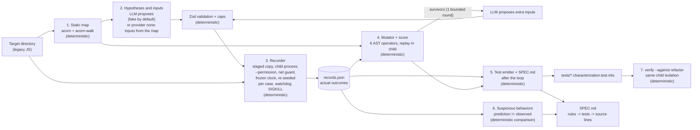

# legacy-archaeologist

[](https://github.com/flaviorg/legacy-archaeologist/actions/workflows/ci.yml) [](LICENSE) [](.nvmrc)

Characterization tests and a living spec for legacy JavaScript, where the real code, not the LLM, writes every expected value, and a mutation score measures whether the recorded cases detect changes to the code.

## The problem

Nobody dares to touch an undocumented legacy module, and coverage is a weak guide to whether its tests would notice a change: Inozemtseva and Holmes (ICSE 2014) generated 31,000 test suites for five Java systems and found only a low to moderate correlation between coverage and mutation-based effectiveness once suite size is controlled (Java systems; the claim is about the general relationship). "AI-generated tests" usually assert whatever the model guessed: TestPilot reached 70.2% median statement coverage on 25 npm packages with LLM-written tests whose expectations the model chose (a coverage number, not a measure of behavior capture). This tool runs the code in an isolated child so that reality records every expected value, lets the LLM only propose inputs, and measures with a mutation score whether those recorded cases detect changes to the code; it also runs with no LLM at all, and says which parts are scripted in offline mode.

| | Deterministic code decides | The LLM only |
|---|---|---|
| Static map | everything (acorn parse, exports, scope, side effects, complexity) | reads it |
| Inputs to try | validation, caps, dedup, boundary expansion, IDs; with `none`, the inputs themselves | proposes partitions, probes, labels |
| Expected values | recorded from the real code in a sandboxed child, twice | nothing (predictions only classify rules) |
| Kill verdict and score | AST mutants, replay, one comparator, Stryker's formula | may flag "likely equivalent" (advisory) |

The full table is in [docs/architecture.md](docs/architecture.md#who-decides-what).

## Run it

```bash
npm ci && npm run demo
```

No Docker, no key, no `.env`, no network after `npm ci`. The block below is printed by the demo and pasted here by `npm run regen`; every number comes from that run's artifacts. The featured `lateFee` line is an author choice (the most legible quirk of the fixture).

<!-- demo-hero:start -->
```text
legacy-archaeologist 0.1.0 · demo · no network · no key
fixtures/legacy-billing is a fixture we wrote with known quirks; the tool flags them without being told where they are:
  ✔ lateFee paid ten days early on 300.00 returns -4.5 (a credit): flagged as SB-03, not fixed
  ✔ the broken refactor fails 5 recorded cases (roundMoney, applyDiscount, calculateInvoice); the modern one passes all 96
bytes@3.1.2, code we did not write, no LLM: 3 functions · 111 stable cases · mutation score 48.6% · 38 surviving mutants
mutation score on the fixture · none 31.6% · fake 90.2% (scripted: author-written survivor inputs; proves the loop, not the model)
artifacts: artifacts/demo/SPEC.md · artifacts/demo/tests/ · artifacts/demo/llm-trace.jsonl · artifacts/demo-third-party/SPEC.md
```
<!-- demo-hero:end -->

<details><summary>Full demo log</summary>

<!-- demo-log:start -->
```text

legacy-archaeologist 0.1.0 · demo · no network · clock 2023-11-14T22:13:20.000Z · seed 42
target: fixtures/legacy-billing (1 file, 152 lines, sha256 688d8c7a321a)

── pass A · provider: none (no LLM; inputs derived from the static map) ──
[1/6] static map        7 exported functions · 1 callback-style · hotspots: calculateInvoice (5), prorate (5)
                        side effects: Date ×3, Math.random ×1, global-write ×1, module-state-write ×1 · unresolved calls: 0
[2/6] inputs            baseline value table · 0 rules · 332 derived inputs · 116 rejected (CAP_CASES ×94, DUPLICATE ×22)
[3/6] recording         240 cases · run twice · 240 stable · 0 unstable · 0 not characterized
[4/6] mutation          133 mutants (AOR 30, ROR 10, LOR 3, NEG 9, NUM 67, BLOCK 14) · 0 invalid
                        round 0: killed 42 · timeout 0 · survived 91 · no-coverage 0 → mutation score 31.6%
[5/6] tests + SPEC.md   240 tests → artifacts/demo-baseline/tests/billing.characterization.test.mts · SPEC.md 199 lines
[6/6] rules             none (no LLM)

── pass B · provider: fake (scripted) ──
[1/6] static map        same map (sha256 688d8c7a321a)
[2/6] hypotheses (LLM)  7 calls · 17 rules · 35 proposed inputs · 0 rejected
[3/6] recording         96 cases · run twice · 96 stable · 0 unstable · 0 not characterized
                        child: --permission, net guard, fd 3 + nonce, watchdog 3.0 s per case · 0 timeouts
[4/6] mutation          133 mutants · 0 invalid · same 133 valid mutants as pass A
                        round 0: killed 109 · timeout 0 · survived 24 · no-coverage 0 → mutation score 82.0%
                        round 1 (LLM, scripted): 10 survivors asked · 13 inputs proposed · 11 accepted · recorded on the original code
                                                 11 more killed → 90.2% (13 survivors left, 1 flagged "likely equivalent" by the LLM, advisory)
[5/6] tests + SPEC.md   96 tests → artifacts/demo/tests/billing.characterization.test.mts · SPEC.md 174 lines
[6/6] rules             13 consistent · 3 contradicted · 1 unverified
                        SB-01 roundMoney(-0.125): predicted -0.13, observed -0.12 (billing.js:19-21)
                        SB-02 applyDiscount(100, "VIP"): predicted 90, observed 100 (billing.js:35-47)
                        SB-03 lateFee(Date(2023-11-24T22:13:20.000Z), Date(2023-11-14T22:13:20.000Z), 300): predicted 0, observed -4.5 (billing.js:82-89)

verify --against fixtures/refactors/modern   96 tests · 96 passed · 0 failed   ✔ behavior preserved on recorded cases
verify --against fixtures/refactors/broken   96 tests · 91 passed · 5 failed   ✔ caught (expected)
  [billing.js#roundMoney#c01]       probe BR-01 … expected returned -0.12, actual returned -0.13
  [billing.js#roundMoney#c07]       boundary of billing.js#roundMoney#c01 … expected returned -0.13, actual returned -0.14
  [billing.js#roundMoney#c08]       boundary of billing.js#roundMoney#c01 … expected returned -0.11, actual returned -0.12
  [billing.js#applyDiscount#c01]    probe BR-01 … expected returned 100, actual returned 90
  [billing.js#calculateInvoice#c02] probe BR-02 … expected callback [null, {"number": "INV-2023-1001", "customer": "Cy", "subtotal": 100, "discount": 0, "tax": 7.25, "total": 107.25, "ref": "R601103"}], actual callback [null, {"number": "INV-2023-1001", "customer": "Cy", "subtotal": 100, "discount": 10, "tax": 6.53, "total": 96.53, "ref": "R601103"}]

── pass C · fixtures/third-party/bytes (bytes@3.1.2, MIT, not written by the author) · provider: none (no LLM) ──
[1/6] static map        3 exported functions · 0 callback-style · hotspots: format (20), parse (6)
                        side effects: none · unresolved calls: 0
[2/6] inputs            baseline value table · 0 rules · 100 derived inputs · 9 rejected (DUPLICATE ×9)
[3/6] recording         111 cases · run twice · 111 stable · 0 unstable · 0 not characterized
[4/6] mutation          74 mutants (AOR 4, ROR 11, LOR 10, NEG 17, NUM 13, BLOCK 19) · 0 invalid
                        round 0: killed 36 · timeout 0 · survived 38 · no-coverage 0 → mutation score 48.6%
[5/6] tests + SPEC.md   111 tests → artifacts/demo-third-party/tests/index.characterization.test.mts · SPEC.md 107 lines
[6/6] rules             none (no LLM)

mutation score · none 31.6% · fake (scripted: author-written survivor inputs) 90.2% · same formula, same 133 mutants, 240 vs 96 recorded cases
artifacts: artifacts/demo-baseline/ · artifacts/demo/{map,hypotheses,records,mutation,report}.json · SPEC.md · tests/ · llm-trace.jsonl · artifacts/demo-third-party/
```
<!-- demo-log:end -->

</details>

| Fixture: fixtures/legacy-billing, same mutants | none (no LLM) | real model | fake (scripted: author-written survivor inputs) |
|---|---|---|---|
| Mutation score | 31.6% | not run | 90.2% |
| Model and date | — | not run | — |

- The `none` baseline is a floor built from the static map alone (parameter positions, structured seeds, magic numbers), not a benchmark.
- A *consistent* rule covers only the probes the model chose; `SPEC.md` prints them next to the status.

> **The lying-LLM test.** We ship a test where the LLM lies about every prediction and every rule. With the same proposed inputs, `records.json`, the generated test file and `support.mts` do not change by one byte; `SPEC.md`, `report.json`, `hypotheses.json` and the trace do. See `[LLM-03]` in [tests/demo/demo.e2e.test.ts](tests/demo/demo.e2e.test.ts).

## What you get

**A `SPEC.md` where rules link to the tests and lines that evidence them** (excerpt of [tests/golden/demo/SPEC.md](tests/golden/demo/SPEC.md)): one consistent rule, one contradicted rule and its suspicious-behavior entry.

### lateFee(dueDate, paidDate, amount) — billing.js:82-89 · complexity 2 · hotspot #4

| Rule | Statement (LLM hypothesis) | Status | Probes (inputs → observed) | Evidence (tests) | Source |
|---|---|---|---|---|---|
| BR-01 | A late payment costs 1.5% of the amount per started week. | consistent (2 probes) | (Date(2023-11-07T22:13:20.000Z), Date(2023-11-14T22:13:20.000Z), 300) → 4.5 · (Date(2023-11-06T22:13:20.000Z), Date(2023-11-14T22:13:20.000Z), 300) → 9 | [c01](tests/golden/demo/tests/billing.characterization.test.mts#L438), [c02](tests/golden/demo/tests/billing.characterization.test.mts#L445) | billing.js:82-89; constant 0.015 at line 88; constant 7 at line 84 |
| BR-03 | Paying before the due date costs nothing. | **contradicted** → SB-03 | (Date(2023-11-24T22:13:20.000Z), Date(2023-11-14T22:13:20.000Z), 300) → -4.5 (predicted 0) | [c04](tests/golden/demo/tests/billing.characterization.test.mts#L459) | billing.js:82-89 |

### SB-03 · billing.js#lateFee · BR-03

- Hypothesis (LLM): Paying before the due date costs nothing.
- Predicted for `lateFee(Date(2023-11-24T22:13:20.000Z), Date(2023-11-14T22:13:20.000Z), 300)`: returns 0.
- Observed (recorded, run twice, stable): returned -4.5.
- Source: billing.js:82-89.
- Test that pins the observed behavior: [billing.js#lateFee#c04](tests/golden/demo/tests/billing.characterization.test.mts#L459).
- Note: the tool records what the code does. Decide with the business whether this behavior is intended; if you change it, this test is the one that must change.

**A generated test** (from [tests/golden/demo/tests/billing.characterization.test.mts](tests/golden/demo/tests/billing.characterization.test.mts)); the expected value was recorded, and the test runs with plain `node --test` through the self-contained `support.mts`:

```js
test("[billing.js#lateFee#c04] probe BR-03: paid ten days early on 300.00", async () => {
  const m = await loadFresh(MODULE_REL, MODULE_NAME, import.meta.url);
  const actual = capture(() => m.lateFee(revive({"$t":"Date","v":"2023-11-24T22:13:20.000Z"}), revive({"$t":"Date","v":"2023-11-14T22:13:20.000Z"}), 300));
  const expected = {"kind":"returned","value":-4.5};
  assert.ok(outcomesEqual(actual, expected), describeOutcome(expected, actual));
});
```

**A broken refactor caught.** `fixtures/refactors/broken/billing.ts` is the modern TypeScript rewrite plus two "obvious fixes":

```diff
-export const roundMoney = (n: number): number => Math.floor(n * 100 + 0.5) / 100;
+export const roundMoney = (n: number): number => Math.sign(n) * Math.round(Math.abs(n) * 100) / 100;
-    if (subtotal > 100) {
+    if (subtotal >= 100) {
```

`npm run la -- verify --tests-dir artifacts/demo/tests --out /private/tmp/la-v --against fixtures/refactors/broken` (exit 3; stdout and the final error line as printed, while npm's own lines and the JSON log lines on stderr are left out):

```text
verify: 96 tests, 91 passed, 5 failed  (target: fixtures/refactors/broken)
  FAIL [billing.js#roundMoney#c01] probe BR-01: negative eighth of a cent
       expected returned -0.12   actual returned -0.13
  FAIL [billing.js#roundMoney#c07] boundary of billing.js#roundMoney#c01: negative eighth of a cent / arg 1 -0.01
       expected returned -0.13   actual returned -0.14
  FAIL [billing.js#roundMoney#c08] boundary of billing.js#roundMoney#c01: negative eighth of a cent / arg 1 +0.01
       expected returned -0.11   actual returned -0.12
  FAIL [billing.js#applyDiscount#c01] probe BR-01: subtotal exactly 100.00 with VIP
       expected returned 100   actual returned 90
  FAIL [billing.js#calculateInvoice#c02] probe BR-02: VIP customer at exactly 100.00 of lines
       expected callback [null, {"number": "INV-2023-1001", "customer": "Cy", "subtotal": 100, "discount": 0, "tax": 7.25, "total": 107.25, "ref": "R601103"}]   actual callback [null, {"number": "INV-2023-1001", "customer": "Cy", "subtotal": 100, "discount": 10, "tax": 6.53, "total": 96.53, "ref": "R601103"}]
error: VERIFY_FAILED: 5 failing tests
```

**Surviving mutants in code the author did not write.** On the vendored `bytes@3.1.2` the `none` run leaves 38 survivors (`bytes` 1, `format` 24, `parse` 13): mutations no baseline input detects. A few from [tests/golden/third-party/bytes/mutation.json](tests/golden/third-party/bytes/mutation.json):

| Mutant | Function | Line | Operator | Change |
|---|---|---|---|---|
| `m-0028` | `format` | 97 | `ROR` | `>=` → `>` |
| `m-0031` | `format` | 99 | `ROR` | `>=` → `>` |
| `m-0042` | `format` | 112 | `AOR` | `/` → `*` |
| `m-0045` | `format` | 119 | `NEG` | `thousandsSeparator` → `!(thousandsSeparator)` |
| `m-0060` | `parse` | 146 | `ROR` | `!==` → `===` |
| `m-0064` | `parse` | 157 | `NUM` | `10` → `11` |
| `m-0069` | `parse` | 162 | `NUM` | `4` → `5` |
| `m-0074` | `parse` | 169 | `AOR` | `*` → `/` |

The `>=` → `>` survivors say no baseline input sits exactly on a unit boundary (1 KB, 1 MB, ...); the `thousandsSeparator` one says no input passes that option. That is the kind of gap a proposed input closes.

## How it works



1. **Static map** (acorn): modules, exported functions, side effects, magic numbers, complexity. Deterministic.
2. **Hypotheses and inputs**: the LLM proposes rules with predictions, partitions and boundary values (or `none` derives inputs from the map); Zod and the planner validate, deduplicate and cap them.
3. **Recorder**: the staged copy runs in a `--permission` child with a network guard, a frozen clock and a seeded random, a fresh module per case, twice. Deterministic.
4. **Mutator and score**: six AST operators, replay against the recorded cases, Stryker's formula; one bounded survivor round asks the LLM for extra inputs, recorded on the original code.
5. **Test emitter and `SPEC.md`**: after the loop, from the map and the records only. Deterministic.
6. **Suspicious behaviors**: a prediction that differs from the recorded outcome is flagged for humans, never fixed.
7. **`verify --against`**: the generated tests against another copy of the module, one isolated child per file.

Legend: deterministic code decides everything except the two "LLM proposes" boxes; in offline mode those answers are scripted (`fake`) or absent (`none`).

## Isolation, honestly

- Trusted code only: the harness is a seat belt, not a sandbox. Any target or `--against` folder outside `fixtures/`, and a `verify --tests-dir` outside `fixtures/` and `artifacts/`, needs `--i-trust-this-code`, and the CLI prints a five-line threat summary otherwise.
- The child cannot write files, spawn processes, start workers or load addons (`--permission`), reads only the harness, the contracts and the staged copy, and gets a scrubbed environment.
- `--permission` does not block the network on Node 24.21; a guard loaded with `--import` does (including loopback), and a native socket module would bypass it.
- Dot-files such as a `.env` next to the code are never staged or readable, but every other file of the target folder is copied in plain text to `<out>/stage/original` and readable by the child: point the tool at the module's folder, not a repository root, and keep `--out` under the ignored `artifacts/`.
- Details and the measured behavior: [docs/threat-model.md](docs/threat-model.md).

## Mutation score, honestly

- `mutationScore = (killed + timeout) / (killed + timeout + survived + noCoverage) × 100`. Same formula as Stryker so the definitions match; the scores are not comparable because the operator sets differ.
- Six operators, inside exported functions only: `AOR`, `ROR`, `LOR`, `NEG`, `NUM`, `BLOCK`.
- `mutation.json` has a per-operator breakdown: `NUM` makes up to three mutants per literal (67 of the fixture's 133), so on well-probed code they are the easiest to kill and inflate the headline; read the breakdown.
- The LLM's "likely equivalent" flag is advisory and never changes the number.
- The oracle is reality by construction, so the score measures whether the recorded inputs are sensitive to code changes (replayed in the harness with the comparator the emitted tests use), not the quality of hand-written assertions; running the emitted file against each mutant is future work.
- More: [docs/mutation.md](docs/mutation.md).

## What is scripted

- In the demo, the hypotheses, partitions and survivor inputs come from a script ([fixtures/llm/legacy-billing.json](fixtures/llm/legacy-billing.json)).
- Expected values, kill verdicts, rule statuses and scores are never scripted: they are recorded or computed by code.
- The author wrote the survivor turns after reading the real round-0 survivors; that is why the hero says *proves the loop, not the model*, and why the `none` score sits next to it.
- The demo trace is committed: [tests/golden/demo/llm-trace.jsonl](tests/golden/demo/llm-trace.jsonl). No real-model run is published yet, so the `real model` column above reads `not run`; live mode is implemented and exercised by the opt-in test in [tests/live/real-provider.live.ts](tests/live/real-provider.live.ts).
- With a real model: `LLM_PROVIDER=openai-compatible LLM_API_KEY=... npm run demo -- --live`. More: [docs/fake-provider.md](docs/fake-provider.md).

## Using it on your code

```bash
npm run la -- run --target ../your-legacy --out ./artifacts/your-legacy --i-trust-this-code
```

With no key this runs the `none` baseline and says so; with `LLM_PROVIDER=openai-compatible` and `LLM_API_KEY` (see [.env.example](.env.example)) it asks the model. Look first at the suspicious-behaviors section of `SPEC.md` and at the surviving mutants in `mutation.json`. To keep the tests, copy `tests/*.characterization.test.mts` and `support.mts` into the legacy repository: they are `.mts` files with no dependency on this project, `support.mts` sets `TZ=UTC` itself, and they run in a `"type": "commonjs"` repository with `node --test` (each file finds its module through the relative `MODULE_REL` at its top, or through `LA_TARGET_DIR=<folder>` when set). Cases whose outcome only exists inside the sandbox, such as a blocked network call, are listed in `SPEC.md` and not emitted. After a refactor, `npm run la -- verify --tests-dir <tests> --against <new code>` tells you which recorded behaviors changed.

The second target, `fixtures/third-party/bytes` (`bytes@3.1.2`, MIT, vendored unmodified), is code the author did not write; the demo runs it with no LLM, so its map, cases and score were produced without anyone choosing the inputs.

## Limits

- JavaScript only in v1 (what acorn parses: ES5 to ESNext, CommonJS and ESM); TypeScript input is optional future work.
- Modules that require npm packages or files above the target folder are skipped (`EXTERNAL_DEPENDENCY`).
- Module state is captured through exports only; `Intl` is not stubbed.
- Six operators, exported functions only; the LLM may propose poor inputs.
- Characterization is not correctness: the tests pin what the code does, quirks included.
- The `none` baseline is a floor, not a benchmark; the real-model column is a single run, not a benchmark.
- Measured on Node 24 on macOS only; CI (Ubuntu) not run yet (the repository is not published). Timings on the author's Mac: `npm test` 110.1 to 110.3 s and `npm run demo` 82.1 to 82.4 s over three runs, one of them in a clean copy (bounds: 180 s and 90 s; 360 s and 180 s on CI).

## More

- [docs/comparison.md](docs/comparison.md): StrykerJS, approval testing, Diffblue Cover, Pythagora, Keploy, TestPilot and others, with sources and dates.
- [docs/research.md](docs/research.md): the sources behind the claims.
- [docs/architecture.md](docs/architecture.md): layers, dependency rules, artifacts, the child protocol; [docs/adr/](docs/adr/) for the decisions.
- [specs/](specs/): the constitution and six EARS specs; every criterion has a test named after it.
- [AGENTS.md](AGENTS.md), the pre-commit hook ([.githooks/pre-commit](.githooks/pre-commit)) and CI ([.github/workflows/ci.yml](.github/workflows/ci.yml)).

## License

MIT, see [LICENSE](LICENSE). `fixtures/third-party/bytes` keeps its own MIT license.
