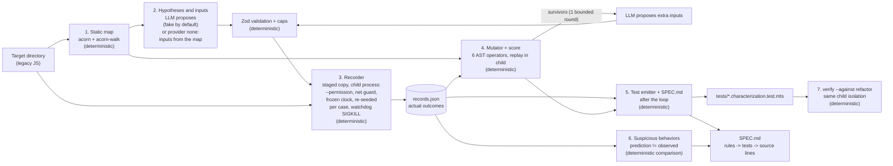

# Architecture

legacy-archaeologist points at a legacy JavaScript folder and returns a static map, characterization tests whose expected values were recorded from the real code, a mutation score for those recorded cases and a living `SPEC.md`. Everything that must be correct is deterministic code; the LLM only proposes inputs and rule hypotheses.

## Pipeline



The source is `docs/diagrams/pipeline.mmd` (validated with mermaid-cli 12.0.0 by `npm run diagrams:check`). `run` executes `map → hypothesize → record → mutate → generate`; `verify` is a separate command. With `LLM_PROVIDER=none`, box 2 is the baseline value table (inputs from parameter positions, structured seeds and magic numbers) and the survivor arrow is absent; everything else is identical, which is what makes the two scores comparable.

No arrow goes from the LLM to a recorded outcome, a kill verdict, the score or the source code. The model's text reaches the target only as function arguments inside the isolated child, and reaches generated files only as escaped string literals (labels in test names; statements and notes in `SPEC.md` only).

## Layers

| Layer | Files | Responsibility |
|---|---|---|
| Contracts | `src/contracts/*.ts` | Zod schemas and types for every artifact, the tagged serializer (`tagged.ts`) and the one outcome comparator (`outcomes.ts`). No I/O |
| Static map | `src/static/*.ts` | Parser adapter (the only value import of `acorn`), scope resolver, exports, side effects, calls, complexity, `buildMap`. Pure |
| Harness | `src/harness/*.ts`, `src/harness/child/*.ts` | Staged copy, the parent that spawns and watches the child, the child program (frozen world, fresh load per case, invocation, fd 3 protocol), the network guard |
| LLM | `src/llm/*.ts`, `src/prompts/v1/*.ts` | `callLlm` (validate, repair once, fail closed, trace), the fake provider, the OpenAI-compatible client, the two prompts |
| Pipeline | `src/pipeline/*.ts` | One stage per file, plus pure helpers: case planner, baseline inputs, rule evaluator, eval table, demo hero and summary |
| Mutation | `src/mutation/*.ts` | Operators, mutator (whole-source tokenizer, string splice), replay runner, score, survivor loop |
| Generate | `src/generate/*.ts` | Test emitter, the `support.mts` template, value formatting, the `SPEC.md` writer. Pure |
| Infra | `src/infra/*.ts` | Config (the only `process.env` reader besides the CLI and scripts), logger, redaction, paths, errors, version, target walking |

## Dependency rules

1. `src/contracts/**` imports only `zod` and other contracts; `tagged.ts` and `outcomes.ts` import only each other (the child loads them).
2. `src/static/**` imports only `acorn`, `acorn-walk`, `src/contracts` and `src/static`, never `node:*`; value imports of `acorn` live only in `src/static/parser.ts`.
3. `src/harness/child/**` imports only Node built-ins, `src/contracts/tagged.ts` and `src/contracts/outcomes.ts`: the child's read grant has no `node_modules`.
4. `src/llm/**` never imports `src/harness` or `src/mutation`: the LLM has no path to execution.
5. `src/generate/**`, the mutator, the score, the operators, the planner, the baseline inputs, the rule evaluator, `eval-llm.ts`, `demo-hero.ts` and `demo-summary.ts` are pure: no `node:fs`, no `node:child_process`, no `process.env`.
6. Only `src/cli.ts`, `src/infra/config.ts` and `scripts/*.ts` read `process.env` (plus the child's `LA_NONCE` and the emitted text inside `support-template.ts`).
7. Erasable syntax only (`erasableSyntaxOnly`): no `enum`, `namespace`, parameter properties or decorators.
8. `src/generate/emit-tests.ts` and `support-template.ts` import nothing from the rule evaluator, the hypothesis or report contracts or `src/llm`, and `emitTests` takes no evaluated rule: the lying-LLM claim (LLM-03) rests on the emitter never seeing a status or a statement.

Rules 1 to 6 and 8 are checked by `tests/unit/conventions.unit.test.ts`; rule 7 by `tsc`.

## Artifacts and who writes them

Every artifact lives under `--out` (default `artifacts/<target base name>/`), carries `schemaVersion`, `tool` and `targetSha`, and is written with stable key order. No golden-compared artifact contains a timestamp, a duration or an absolute path.

| Artifact | Written by | Content |
|---|---|---|
| `map.json` | map stage | Files, modules, exported functions, side effects, magic numbers, calls, complexity, hotspots |
| `hypotheses.json` | hypothesize stage (rejections appended by mutate) | The provider's validated proposals per function, and every rejected input with its reason |
| `llm-trace.jsonl` | hypothesize and mutate stages | One line per LLM call: prompt, match keys, user message, raw text, parsed output, validation, repair raw text. Empty with `none` |
| `records.json` | record stage (rewritten after the survivor loop) | Every case with its arguments, recorded outcomes, `stateAfter` and determinism |
| `timings.json` | record and mutate stages | Step and batch durations (never golden-compared) |
| `mutation.json` | mutate stage | Every mutant with its status, the rounds, `replayedCases` and the score with `byOperator` |
| `tests/*.characterization.test.mts`, `tests/support.mts` | generate stage | The emitted tests, from the map and the records only |
| `report.json`, `SPEC.md` | generate stage | Evaluated rules, suspicious behaviors, not-characterized cases, side effects, mutation summary |
| `verify.json` | `verify` | Per test file: tests, passed, failed, timed out, failures with expected and actual |
| `stage/original/` | stage | The staged copy the child reads (`mutants/` copies are derived from it and removed after the run) |

## The child protocol

The parent spawns one child per batch:

```text
node --permission --allow-fs-read=<src/harness/child> --allow-fs-read=<src/contracts> --allow-fs-read=<staged target>
     --import <file:// URL of net-guard-entry.ts> <src/harness/child/main.ts>
cwd: the staged target · env: TZ=UTC, LANG=C, LC_ALL=C, NODE_OPTIONS="", PATH="", LA_NONCE=<32 hex>
stdio: [job on stdin, stray stdout, stray stderr, protocol on fd 3]
```

- Each `--allow-fs-read` value is one argv element (paths with spaces work); the target is passed as its real path.
- The child reads and deletes `LA_NONCE` before any case runs, writes `hello`, reads the job, freezes the world once (frozen `Date`, mulberry32 `Math.random` seeded with 42, counters for `performance.now` and `process.hrtime`, deterministic `crypto` stubs) and re-seeds it at the start of every case.
- Each case loads a fresh module instance (CommonJS: cache purge and `createRequire`; ESM: `import()` with `?la=<n>`, passed on to every static import inside the target by a `module.registerHooks` resolve hook), runs its steps, clears the timers it created and writes one NDJSON line with the nonce on fd 3.
- The parent drops fd 3 lines without the nonce (`forgedLines`), counts stray stdout and stderr, and arms a per-case watchdog of `steps × caseTimeoutMs + watchdogMarginMs` (2,000 ms per step plus 1,000 ms by default), re-armed for the next case on every line. On a watchdog, a child exit without `done` or an output cap (stdout 4 MiB, stderr 64 KiB, fd 3 line 1 MiB) it SIGKILLs the child, re-runs that case once in a fresh child and re-spawns from the next case.
- Every batch runs twice; a case whose two runs differ is `unstable` and excluded from tests and from kills.
- Replay (mutation) uses the same spawn with a per-case budget of `clamp(10 × recorded duration, 2,000 ms, steps × caseTimeoutMs)` and stops at the first difference; a timed-out mutant is replayed once more with the full budget before it counts as `timeout`.

## Who decides what

| Feature | Deterministic code decides | The LLM only | How the split is tested |
|---|---|---|---|
| Static map | Everything: parse, exports, scope, calls, side effects, complexity, magic numbers | nothing (it reads the map) | MAP-01 to MAP-08 run with no provider at all |
| Which inputs to try | Validation, caps, dedup, boundary expansion, IDs, ordering; with `none`, the inputs themselves (baseline value table) | proposes partitions, boundary values, probe inputs, labels | HYP-01 to HYP-06; `plan-cases.unit` with hostile proposals; `baseline-inputs.unit` |
| Expected values | Recorded from execution in the sandboxed child, twice | nothing; predictions are stored on rules, never on cases | LLM-03: a lying fake changes no byte of `records.json` or the tests |
| Business rules in `SPEC.md` | Status (`consistent`/`contradicted`/`unverified`) by comparing prediction with record; probe count; evidence links; source lines | proposes the statement, the prediction, the probes and related constants (so "consistent" covers only the probes the model chose, and `SPEC.md` prints them) | SUS-01, SUS-02, `evaluate-rules.unit` |
| Suspicious behaviors | The disagreement itself and its evidence | wrote the hypothesis that disagreed | SUS-01 to SUS-03 |
| Mutants | Generated by AST operators; stable IDs | nothing | MUT-01 to MUT-03; `mutator.unit` without a provider |
| Kill verdict and score | Replay, `outcomesEqual` and `stateAfter`; Stryker's formula; per-operator breakdown | may flag "likely equivalent" (advisory, never in the number) | MUT-04, MUT-05, MUT-09 |
| Survivor loop | Bound, selection order, recording on the original code, re-run | proposes extra inputs | MUT-06, MUT-07 |
| Refactor verification | One `--permission` child per generated file, TAP parsed by code | nothing | GEN-06, GEN-07, GEN-08 |
| The LLM's contribution | `eval-llm`: the delta between the `none` run and a provider's run on the same mutants | nothing (it is the subject of the measurement) | DEMO-04, DEMO-05 |
| Code changes | none, ever | none, ever | SUS-03 |

## Scope resolver limits

The scope resolver is hand-written and minimal: module-level bindings (`var`, `let`, `const`, function declarations) and, per function, its parameters and local declarations at any depth (`var` hoisted). A `let` in an inner block counts as local to the function. Identifiers inside a `with` body, and every identifier of a file that contains a direct `eval(...)` call, are classified `unresolved` (never guessed), counted in `stats.unresolvedIdentifiers` and listed in `SPEC.md`. Calls are resolved by name to module-level functions of the same file only; no cross-function call graph is built in v1.

## v1 limits

- JavaScript only (what acorn parses: ES5 to ESNext scripts and modules, CommonJS and ESM); TypeScript input is optional future work.
- Modules that require npm packages or files above the target folder are skipped with `EXTERNAL_DEPENDENCY`.
- Module state is captured through exports only (`stateAfter`); `Intl` is not stubbed.
- Six mutation operators, inside exported functions only.
- At most 200 files and 2 MiB staged, 50 exported functions per run, 40 cases per function, 200 mutants, one survivor round of 10 survivors × 5 inputs.
- Measured on Node 24 (macOS and Ubuntu) only.
